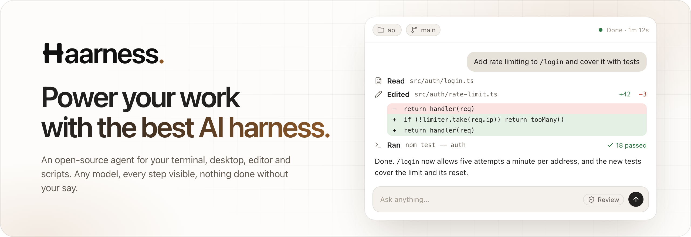
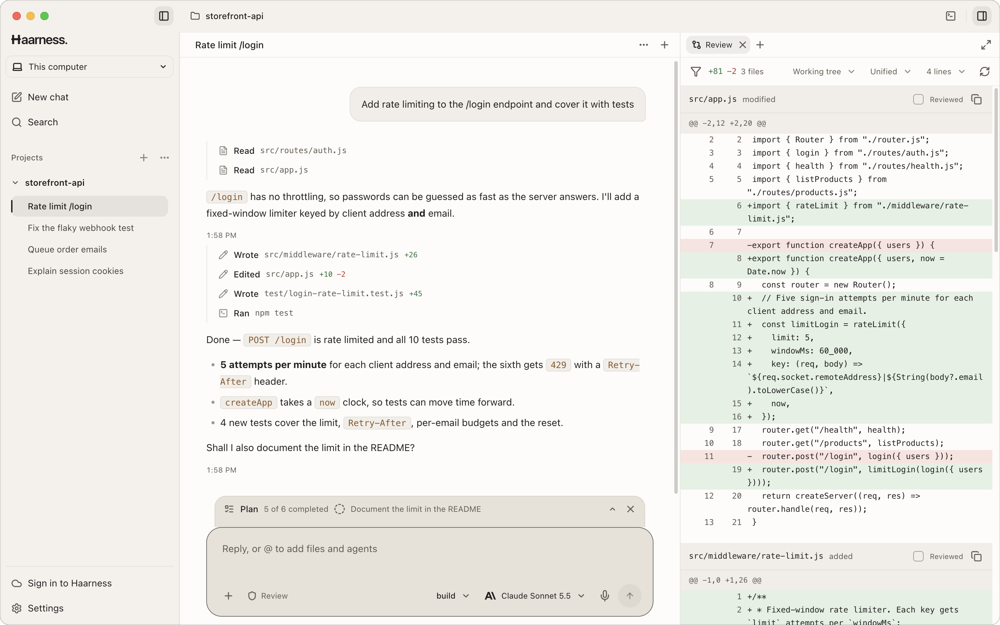
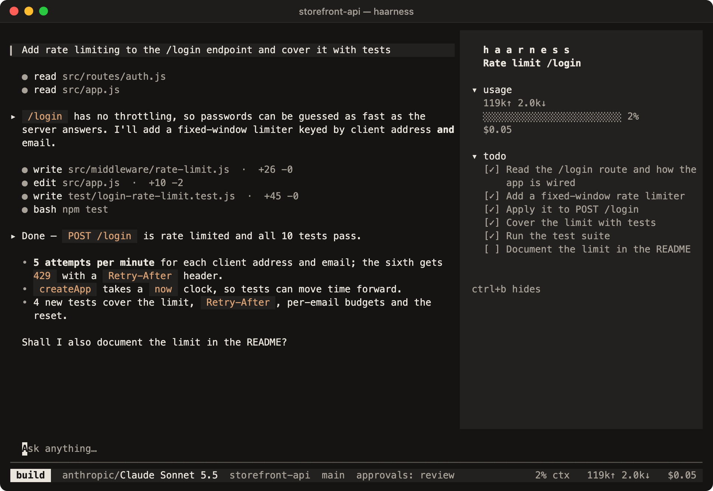

<p align="center">
  <a href="https://haarness.ai">
    <picture>
      <source media="(prefers-color-scheme: dark)" srcset=".github/assets/banner-dark.png">
      
    </picture>
  </a>
</p>

<p align="center">
  <a href="https://haarness.ai"><b>Website</b></a>&nbsp;&nbsp;·&nbsp;&nbsp;<a href="https://haarness.ai/docs"><b>User guides</b></a>&nbsp;&nbsp;·&nbsp;&nbsp;<a href="#install"><b>Install</b></a>&nbsp;&nbsp;·&nbsp;&nbsp;<a href="docs/README.md"><b>Engineering docs</b></a>&nbsp;&nbsp;·&nbsp;&nbsp;<a href="CONTRIBUTING.md"><b>Contributing</b></a>
</p>

<p align="center">
  <a href="LICENSE"></a>
  
  
  <a href="locales/README.md"></a>
</p>

**Haarness is the harness around the model** — the tools, memory and guard rails that let AI do real
work and show you every step. One open-source agent works in your project from a terminal UI, a desktop
app, your editor, scripts and CI, and keeps going in [Haarness Cloud](https://haarness.ai) when you
close the lid.

A local server owns every chat, turn and tool call and keeps them durable: closing a window or losing a
connection never stops the work, and every client sees the same chats. The CLI, server and terminal UI
are one Rust executable.

<p align="center">
  <picture>
    <source media="(prefers-color-scheme: dark)" srcset=".github/assets/desktop-dark.png">
    
  </picture>
</p>

## Why Haarness

<table>
<tr>
<td width="50%" valign="top">

**One agent, every screen.** The terminal UI, Desktop, your editor (through the Agent Client Protocol),
scripts, the SDKs and Haarness Cloud are all clients of the same server, with the same tools and rules.

</td>
<td width="50%" valign="top">

**Any model you already use.** Sign in with ChatGPT, GitHub Copilot or xAI, bring keys for OpenAI,
Anthropic, Gemini, OpenRouter and dozens more, run Ollama or LM Studio locally, or use one Haarness account.

</td>
</tr>
<tr>
<td valign="top">

**You stay in charge.** Each chat is in Review or Auto. Rules are plain text you can read, and every
file read, command run and edit sits in the transcript, in order, with what it cost.

</td>
<td valign="top">

**Built to finish the job.** Plans, persistent goals, helper agents that run in parallel, JavaScript
and TypeScript workflows, and schedules registered with your operating system.

</td>
</tr>
<tr>
<td valign="top">

**Extensible all the way down.** MCP servers over stdio, HTTP and SSE with OAuth, Agent Skills,
plugins and marketplaces, custom agents and slash commands, TypeScript extensions.

</td>
<td valign="top">

**Durable by design.** Thread → turn → item history in SQLite, idempotent turns, ordered events with
replay, and restart recovery that never replays a shell command or an edit.

</td>
</tr>
</table>

## Install

One command installs the CLI and terminal UI, then the Desktop app. It checks each download's
SHA-256 before it replaces anything, and needs no administrator rights.

**macOS and Linux**

```sh
curl -fsSL https://haarness.ai/install.sh | sh                      # CLI, terminal UI and Desktop
curl -fsSL https://haarness.ai/install.sh | sh -s -- --no-desktop   # CLI and terminal UI only
```

**Windows** (PowerShell)

```powershell
irm https://haarness.ai/install.ps1 | iex                                    # CLI, terminal UI and Desktop
$env:HAARNESS_NO_DESKTOP='1'; irm https://haarness.ai/install.ps1 | iex      # CLI and terminal UI only
```

<table>
<tr><th></th><th>macOS</th><th>Linux</th><th>Windows</th></tr>
<tr><td><b>CLI</b></td><td><code>~/.local/bin/haarness</code></td><td><code>~/.local/bin/haarness</code></td><td><code>%LOCALAPPDATA%\Haarness\bin</code>, added to your PATH</td></tr>
<tr><td><b>Desktop</b></td><td><code>/Applications/Haarness.app</code> (<code>~/Applications</code> if that is not writable)</td><td>AppImage with a <code>haarness-desktop</code> command and a menu entry (only with a graphical session)</td><td>Its setup wizard, then the Start menu</td></tr>
<tr><td><b>Downloads</b></td><td><code>.dmg</code> · <code>.zip</code></td><td><code>.AppImage</code> · <code>.deb</code></td><td><code>.exe</code></td></tr>
<tr><td><b>Runs on</b></td><td>Apple silicon and Intel</td><td>x64 and ARM64; CLI on glibc 2.17+, Desktop on GTK 3 desktops such as Ubuntu 20.04+</td><td>x64 and ARM64, Windows 10 and 11</td></tr>
</table>

On Debian and Ubuntu you can also install Desktop system-wide from the
[download page](https://haarness.ai/download): `sudo apt install ./Haarness-<version>-linux-x64.deb`.
`haarness desktop` opens Desktop (and installs it first if you skipped it). `haarness doctor` checks an
install and `haarness upgrade` replaces the CLI with a newer release; `HAARNESS_CHANNEL=preview` selects
preview builds, `HAARNESS_VERSION` pins one and `HAARNESS_PRODUCT=cli` or `desktop` installs only that one.
Full guide:
[Install Haarness](https://haarness.ai/docs/start/install).

## Quick start

**1. Connect a provider.**

```sh
cd your-project
haarness
```

With nothing connected, the terminal UI opens on **Connect a provider**: choose **Haarness Cloud**,
sign in with a ChatGPT, GitHub Copilot or xAI subscription, or paste an API key for OpenAI,
Anthropic, Google Gemini, OpenRouter or any other provider in the list. A running Ollama or LM Studio
is detected without this step, and `/connect` opens the same picker later. From a shell instead:

```sh
haarness login                # Haarness Cloud account (--device on a machine without a browser)
haarness auth login openai    # ChatGPT Plus/Pro in the browser (--method headless for a code)
haarness auth set anthropic   # asks for an API key; a piped key works too
```

Provider variables such as `OPENAI_API_KEY` and `ANTHROPIC_API_KEY` work as well. Full guide:
[Connect a provider](https://haarness.ai/docs/start/connect-a-provider).

**2. Ask for something.** Type your request at **Ask anything…** and press Enter. `/` lists commands,
`@` attaches files or hands work to an agent, and `!` runs a shell command. Quitting leaves running
work on the server; `haarness -c` continues the last chat. Full guide:
[Your first chat](https://haarness.ai/docs/start/first-session).

In Desktop, choose **Open project** and pick a folder. The **Welcome to Haarness** dialog connects
Haarness Cloud or a provider; then type in the message box and press Enter. See the
[Desktop first run](docs/DESKTOP.md#first-run) and the full guide,
[Install and first run](https://haarness.ai/docs/desktop/install).

**3. Script it.**

```sh
haarness run "Summarize what this project does"
git diff | haarness run "Review this change"
haarness run -m anthropic/claude-sonnet-5-5 --file ./brief.pdf "Check the code against this brief"
haarness run --format json "List the open TODOs"   # newline-delimited JSON records
```

`haarness run` uses your default model, else a connected provider's. With no terminal to ask at (a
script, CI), a permission request is refused and the run stops, naming what was asked: allow it with a
permission rule, or pass `--yolo` where the damage is bounded. `--auto` instead puts the chat in Auto,
where it stays for every app until switched back. Ctrl-C stops the run's work on the server and exits
with status 130. See
[Run a prompt from a script or CI](https://haarness.ai/docs/cli/headless-runs).

## Everywhere you work

| Surface | What you get |
| --- | --- |
| **Terminal UI** | A quiet, keyboard-first interface: activity rows, inline diffs, approvals, tabs, workspace terminals and 17 languages. `haarness` |
| **Desktop** | macOS, Windows and Linux: streaming chats, diff review, a file editor, terminals and a built-in browser. [Desktop guide](docs/DESKTOP.md) |
| **Scripts and CI** | `haarness run` with text or JSON output, permission rules instead of prompts. [Reference](docs/REFERENCE.md#command-examples) |
| **Your editor** | `haarness acp` speaks the Agent Client Protocol, with durable sessions visible everywhere. [Set it up](https://haarness.ai/docs/server/acp) |
| **Your Chrome** | Haarness for Chrome lets agents use your own signed-in Chrome; every site asks in each chat. [Use your Chrome](https://haarness.ai/docs/desktop/use-your-chrome) |
| **Your product** | A versioned `/v1` server API with generated TypeScript and Python SDKs. [API](docs/API.md) · [SDKs](sdks/README.md) |
| **Haarness Cloud** | Sessions that keep running, schedules, remote control of your own computers, one account for every model. [haarness.ai](https://haarness.ai) |
| **Your phone** | Follow every chat, approve and answer from the Lock Screen or the notification shade. [Haarness for iPhone](https://github.com/haarness/haarness-ios) · [Haarness for Android](https://github.com/haarness/haarness-android) |

<p align="center">
  
</p>

## Approvals

> [!IMPORTANT]
> Haarness permissions are application-level policy, not an operating-system sandbox. Review
> approval prompts before allowing tools to operate.

Each chat is in **Review** (the default) or **Auto**, stored on the server and shared by every client:
**Ctrl+Y** in the TUI or the shield pill in Desktop's composer changes the open chat, and the choice
survives quitting. In Review, edits and commands inside the project run without asking; Haarness asks
before using files outside the project, reading secrets such as `.env`, switching agents or generating
paid media, plus anything your own rules set to ask. Desktop's browser asks about a site only when
**Settings → Browser** sets it to **Requires approval**. Auto answers those requests itself, except
Haarness Cloud actions that spend money or delete something, which always ask, a site set to
**Requires approval**, which asks unless **Remember site approvals** is on, and a website in your own
Chrome, which only a person can allow.

| Key | Answer |
| --- | --- |
| `y` / `n` | **Allow once** / **Reject** |
| `a` | **Always** — every chat on this server, until the server stops |
| `w` / `r` | **This folder** / **Repository** — saved, so they still apply after a restart |
| `u` | **Once + Auto** — allow this one and switch the chat to Auto |

`a`, `w`, `r` and `u` first show what they grant; Enter or the same key again confirms. An "always"
answer saves the rule shown on the card, which is a pattern: approving `rm -rf build` allows every `rm`
command. See [Permissions and approvals](https://haarness.ai/docs/security/permissions).

**Use your Chrome.** Agents can also work in your own Google Chrome, signed in as you, through the
Haarness for Chrome extension: set it up with `/chrome` in the TUI, **Settings → Browser → Chrome** in
Desktop, or `haarness browser setup`. Each new site asks in each chat (**Allow in Chrome**: `a` allows it
in this chat), and Auto, `--yolo`, hooks and permission rules never answer for you. See
[Use your Chrome](https://haarness.ai/docs/desktop/use-your-chrome).

## Usage statistics

Usage statistics are on by default. A running Haarness server sends Haarness Cloud a daily summary
about every six hours: counts of chats and turns (completed, failed, interrupted, run by subagents or
schedules), tokens, the cost estimate, tool calls and errors by built-in tool, and files changed with
lines added and removed, per provider and model. Providers and models are named only when Haarness
ships them; anything else is reported as `custom`, `other`, `local` or `mcp`. The summary also carries a
random installation id, the app version, the OS and the CPU type, and **never** prompts, answers, code,
file names, paths or titles. It is linked to your Haarness account when you are signed in and anonymous
otherwise.

Turn it off in Desktop **Settings → General → Share usage statistics**, with `/usage-statistics` in the
TUI, `haarness telemetry off`, `HAARNESS_TELEMETRY=0` or `DO_NOT_TRACK=1`. `haarness telemetry preview`
shows exactly what is sent. See [Usage statistics](docs/USAGE-STATISTICS.md).

## Build from source

You need the toolchain pinned in `rust-toolchain.toml` (rustup installs it on first use). Builds are
offline: OpenTUI and ripgrep are vendored, so you need no Bun, Node.js, Zig or separate `rg`.

```sh
cargo build --release
./target/release/haarness doctor
./target/release/haarness
```

Desktop lives in `apps/desktop` and needs Node.js 22+:

```sh
npm run desktop:install
npm run desktop:dev
```

`./scripts/test-all.sh` is the full gate: formatting, architecture boundaries, Clippy, the workspace
suite, a release build, real provider and recovery flows, and a tmux-driven TUI session. See
[CONTRIBUTING.md](CONTRIBUTING.md) for the checks each kind of change needs.

## Repository layout

```text
crates/            the Rust workspace — core state machine, server, providers, MCP, TUI, store, CLI
apps/desktop/      Haarness Desktop (Electron + SolidJS)
apps/browser-extension/   Haarness for Chrome (MV3)
packages/browser-driver/  the CDP page driver Desktop and the extension share
sdks/              generated TypeScript and Python SDKs for the /v1 API
locales/           17 interface catalogs shared by the TUI and Desktop
skills/            Agent Skills for working on Haarness itself
docs/              engineering docs, the reference and dated records
brand/             the logo, wordmark and app icons
```

`haarness-core` owns the agent state machine and its ports and cannot depend on HTTP, SQLite, provider
DTOs, MCP SDK types, CLI parsing or OpenTUI; outer crates implement those ports, and `cargo run -p xtask
-- architecture` enforces it. See [Architecture](docs/ARCHITECTURE.md).

## Documentation

- **[User guides](https://haarness.ai/docs)** — install, first chat, providers, Desktop, CLI, security.
- **[Reference](docs/REFERENCE.md)** — every command family, servers and clients, worktrees, the TUI,
  agents and workflows, schedules, plugins, providers and the full configuration.
- **[Engineering docs](docs/README.md)** — behaviour in detail, the [server API](docs/API.md),
  [configuration scopes](docs/CONFIGURATION-SCOPES.md), [observability](docs/OBSERVABILITY.md) and
  dated records.

## The Haarness family

| Repository | What it is |
| --- | --- |
| **[haarness](https://github.com/haarness/haarness)** | This repository: the agent, terminal UI, Desktop, server and SDKs. Apache 2.0. |
| **[haarness-router](https://github.com/haarness/haarness-router)** | A stateless, OpenAI-compatible model router you can host yourself. MIT. |
| **[haarness-cloud](https://github.com/haarness/haarness-cloud)** | Haarness Cloud: accounts, hosted sessions, the attach gateway, billing and the marketplace. |
| **[haarness-ios](https://github.com/haarness/haarness-ios)** | Haarness for iPhone: remote hosts, Cloud sessions and agents, approvals on the go. |
| **[haarness-android](https://github.com/haarness/haarness-android)** | Haarness for Android: the same remote hosts, Cloud sessions, agents and approvals, for Android phones and tablets. |

## Contributing

Contributions are welcome — read [CONTRIBUTING.md](CONTRIBUTING.md) first. Everyone taking part is
expected to follow the [Code of Conduct](CODE_OF_CONDUCT.md). Report security problems privately as
described in [SECURITY.md](SECURITY.md); see [SUPPORT.md](SUPPORT.md) for where to ask for help.

## License

Haarness is licensed under the [Apache License, Version 2.0](LICENSE). Bundled third-party components
keep their own licenses; see [NOTICE](NOTICE). The Haarness name and logo are not covered by the
license — see [TRADEMARKS.md](TRADEMARKS.md).
